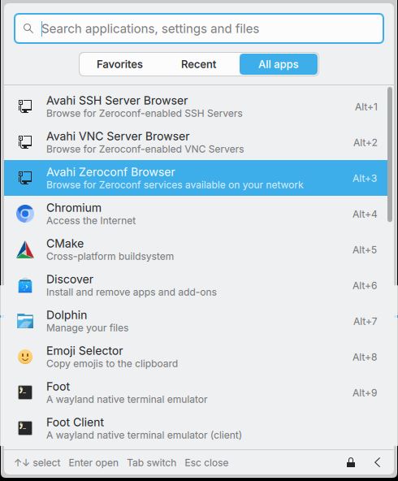

# Flatkit Menu

A Plasma 6 application menu in the flatkit style: a drop-in replacement for
Kickoff that opens from the panel or the Meta key.



- One search field over KRunner: apps, System Settings pages, the
  calculator, files and commands, the same results KRunner gives
- Favorites, Recent and All apps behind a flat segmented switch; favorites
  are Plasma's own, so "Add to Favorites" works as it does in Kickoff
- Right-click (or → / the Menu key) for an app's actions: jump-list entries
  such as "New Private Window", Add to Desktop, Edit Application, Uninstall
- Lock, log out, restart and shut down in the footer
- flatkit's look: Inter, 6px radii, 1px borders that become a 2px accent
  ring on focus, a solid accent selection, and nothing that fades or slides.
  Colours come from your Plasma colour scheme, mapped the way flatkit's
  `KdeColors` maps them

| Key | Does |
| --- | --- |
| Meta | Open or close |
| ↑ ↓, Ctrl+J/K, Ctrl+N/P | Move the selection |
| Page Up/Down | Move by a page |
| Enter | Open |
| Alt+1 … Alt+9 | Open that row |
| Tab, Shift+Tab | Switch Favorites / Recent / All apps |
| →, Menu | The selection's actions |
| Esc | Clear the search, then close |

## Install

```sh
cd kde/menu
./install.sh
```

Then right-click the application menu in your panel, choose **Show
Alternatives…** and pick **Flatkit Menu**. It takes the old menu's place in
the panel, and the Meta key opens it: Plasma sends Meta to whichever menu
in the panel provides `org.kde.plasma.launchermenu`, which this one does.

If you ran `launcher/install.sh --meta` before, this installer hands the
Meta key back to Plasma so it opens this menu.

Run `./install.sh` again after pulling to update (then restart Plasma with
`systemctl --user restart plasma-plasmashell`), and `./install.sh
--uninstall` to remove it.

## Layout

- `package/metadata.json`: the widget's id, `dev.flatkit.menu`, and the
  launcher-menu role that routes Meta to it
- `package/contents/ui/main.qml`: the panel icon and Plasma's menu models
  (`org.kde.plasma.private.kicker`, which Kickoff uses too)
- `package/contents/ui/MenuView.qml`: the popup
- `package/contents/config/main.xml`: settings, including the favorites
  seeded on first run
